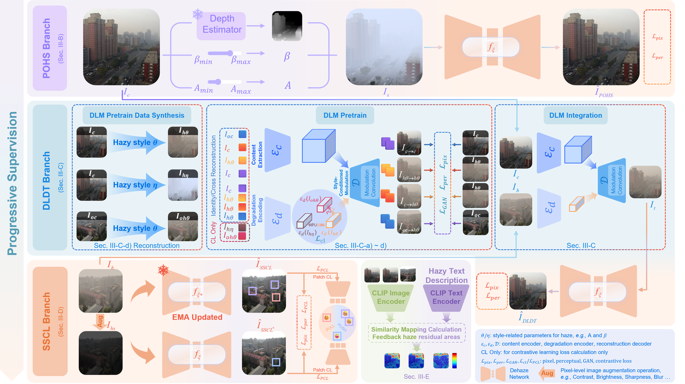
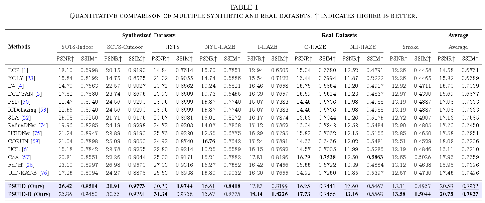
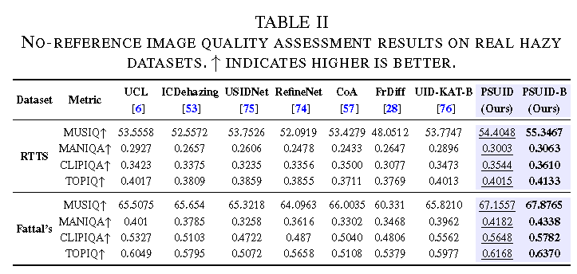

<div align="center">

# 🌫️ PSUID (IEEE TMM 2026)

### **Progressive Supervision with Disentangled Learning and Density-Aware for Image Dehazing from Unpaired Clean and Hazy Images**

<p>
  <a href="pdf/PSUID.pdf">📄 Paper</a> •
  <a href="pdf/PSUID-supp.pdf">📎 Supplementary</a> •
  <a href="weights/">🧠 Pretrained Weights</a> 
</p>

</div>

---

> [!IMPORTANT]
> PSUID learns from **independent clean and hazy image collections**. It does not require geometrically aligned real hazy-clean training pairs, and retains only one NAFNet-based restoration network at inference time.


## 🔍 Overview

PSUID is an unpaired single-image dehazing framework that learns from independent collections of clean and hazy images. It progressively expands the supervision space from reliable physics-based synthetic pairs, through degradation-transferred pseudo-pairs, to hazy images without aligned clean references.

The framework contains four main ideas:

- **Physics-based Online Haze Synthesis (POHS):** generates physically interpretable hazy/clean pairs from clean images using the atmospheric scattering model.
- **Disentangled Learning based Cross-domain Degradation Transfer (DLDT):** separates scene content from haze degradation and transfers real haze characteristics to clean content, producing intermediate-domain pseudo-pairs.
- **Self-supervised Consistency Learning (SSCL):** uses an exponential moving average teacher and strong image augmentation to learn from unpaired real hazy images.
- **Density-Aware Map (DAM):** uses CLIP-based haze-residual perception to emphasize difficult regions during training without adding inference-time cost.

Only the shared dehazing network is retained at inference time. POHS, DLM, and DAM are training-only components.


## 🧩 Method at a Glance




## 📊 Quantitative Results

The following results are reported in the paper across eight paired synthetic and real-world benchmarks:

<details>
	<summary><strong>Quantitative comparison of multiple synthetic and real datasets</strong> (click to expand) </summary>
    <p></p>
	Quantitative comparison with SOTA methods on five popular benchmark datasets. Blue text indicates the best results. `Multi-Adds' is calculated with a 1280 $\times$ 720 HR image.
</details>
<details>
	<summary><strong>No-reference image quality assessment results on real hazy datasets</strong> (click to expand) </summary>
    <p></p>
</details>
> [!TIP]
> Each entry is **PSNR (dB) / SSIM**. PSUID and PSUID-B use different training batch sizes; the repository provides both `PSUID_bs1.pth` and `PSUID_bs4.pth`. The difference between PSUID and PSUID-B lies in the training batch size. We observe that the model trained with a smaller batch size (e.g., 1) achieves higher performance on synthetic datasets, whereas the model trained with a larger batch size performs better on real-world hazy datasets. This behavior can be attributed to the distinct statistical properties of synthetic and real haze data. Smaller batch sizes favor fitting the more deterministic haze patterns in synthetic data, while larger batch sizes provide more stable gradient estimates and improve robustness to the higher variability and noise present in real-world haze. We do not intend to gain advantage by reporting multiple variants. Instead, the consistent performance across both settings demonstrates the robustness under different optimization regimes. 


## 🗂️ Repository Structure

```text
PSUID/
├── basicsr/                     # Restoration framework, models, data, losses, and metrics
│   ├── archs/
│   │   ├── NAFNet_arch.py       # Inference backbone
│   │   ├── DLM_arch.py          # Disentangled Learning Module
│   ├── models/
│   │   ├── PSUID_model.py       # Joint PSUID optimization
│   │   └── PSUID_base_model.py  # Shared model setup and haze synthesis
│   ├── data/                    # Paired and unpaired datasets
│   ├── depth/                   # Depth Anything V2 integration
│   ├── train.py                 # Training entry point
│   └── test.py                  # Config-driven testing entry point
├── dinov3/                      # DINOv3 perceptual feature implementation
├── pyiqa/                       # IQA models and metrics used by evaluation scripts
├── scripts/
│   ├── test_on_custom_dataset.py
│   ├── transfer_demo.py
│   ├── online_synthsize_hazy.py
│   ├── non_ref_test_script.py
│   ├── latency.py
│   └── self_ensemble.py
├── weights/                     # Released checkpoints
├── pics/                        # Example clean/hazy images
└── pdf/                         # Paper and supplementary material
```


## 🛠️ Installation

```bash
git clone https://github.com/liux520/PSUID.git
cd PSUID
```


## 🧠 Pretrained Models

| Checkpoint | Purpose | Approximate size |
|---|---|---:|
| `weights/PSUID_bs1.pth` | PSUID dehazing network trained with batch size 1 | 223 MiB |
| `weights/PSUID_bs4.pth` | PSUID dehazing network trained with batch size 4 | 223 MiB |
| `weights/DegradationTransfer_PSUID.pth` | DLM checkpoint used by PSUID/DLDT | 30 MiB |
| `weights/DegradationTransfer_CSUD.pth` | CSUD degradation-transfer comparison checkpoint | 9.4 MiB |


## 🧪 Evaluation on Benchmark Datasets

```
python scripts/test_on_custom_dataset.py
python scripts/non_ref_test_script.py
```

Before running the script, edit the local settings near its `__main__` block:

1. Set `root` to the benchmark dataset root.
2. Select `PSUID_bs1.pth` or `PSUID_bs4.pth`.
3. Adjust `dataset_lists` to match the datasets available locally.
5. If no-reference metrics are needed, update `_init_nr_metric()` to point to the required IQA checkpoints.

The standalone evaluator expects a layout similar to:

```text
<dataset-root>/
├── Indoor/
│   ├── input/
│   └── target/
├── Outdoor/
│   ├── input/
│   └── target/
├── HSTS/
│   ├── synthetic/
│   ├── original/
│   └── real-world/
├── I_Haze/{Input,GT}/
├── O_Haze/{Input,GT}/
├── D_Haze/{NYU_Hazy,NYU_GT}/
├── NH_haze/{input,target}/
├── Smoke/{hazy,clean}/
├── RTTS/
└── Fattal/
```


## 🧬 Degradation Transfer Demo

```
python scripts/transfer_demo.py
```


### 🧰 Efficiency profiling

```bash
python scripts/latency.py
```


## 📝 Citation
If this work is helpful for you, please consider citing:
```bibtex
@article{liu2026psuid,
  title   = {Progressive Supervision with Disentangled Learning and
             Density-Aware for Image Dehazing from Unpaired Clean and Hazy Images},
  author  = {Liu, Xiao and Wang, Xiaofeng and Ren, Chao},
  year    = {2026}
}
```


## 🙏 Acknowledgements

This codebase builds on or integrates ideas and implementations from:

- [BasicSR](https://github.com/XPixelGroup/BasicSR)
- [NAFNet](https://github.com/megvii-research/NAFNet)
- [Depth Anything V2](https://github.com/DepthAnything/Depth-Anything-V2)
- [DINOv3](https://github.com/facebookresearch/dinov3)
- [CLIP](https://github.com/openai/CLIP) and [CLIP-Surgery](https://github.com/xmed-lab/CLIP_Surgery)
- [pyiqa](https://github.com/chaofengc/IQA-PyTorch)
- [CSUD](https://github.com/GuangluDong0728/CSUD-Unsupervised-Deraining-CVPR2025)

Please cite the corresponding upstream projects when using those components.


## 📜 License

This project is released under the MIT.


## 📬 Contact

 Should you have any question, please create an issue on this repository or contact at [liuxmail1220@gmail.com](mailto:liuxmail1220@gmail.com)

---
